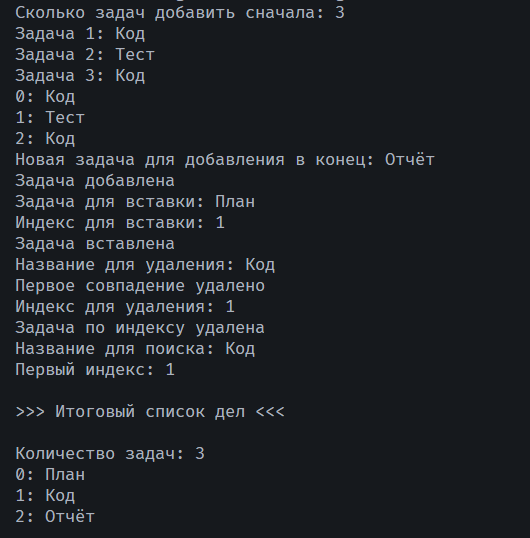

# Практическая работа №21

Автор: Алексеевская Елена

Группа: ИСП-251

## Тема

Коллекция List в C#.

## Что реализовано

- ввод и вывод списка задач;
- добавление и вставка;
- удаление по значению и индексу;
- поиск первого совпадения;
- проверка допустимости индексов;
- обработка пустого списка.

## Короткие ответы

- 1. Чем List отличается от массива и как узнать количество элементов списка?

Ответ: Массив имеет фиксированную длину, а List<> можно расширять и сокращать: элементы добавляются и удаляются методами. Количество элементов у массива определяется `Length`, а у списка - `Count`.

- 2. Чем отличаются Remove() и RemoveAt()?

Ответ: Remove() удаляет первое совпадение по значению и возвращает bool. RemoveAt() удаляет элемент по индексу, ничего не возвращает и требует допустимый индекс, иначе выбрасывает исключение.

- 3. Почему для вставки допустим индекс Count, а для удаления — нет?

Ответ: индекс Count - позиция после последнего элемента. При вставке добавляет в конец - это корректно. При удалении элемента с индексом Count не существует, так как последний индекс это (Count-1), поэтому такое удаление привело бы к исключению.

## Результат

